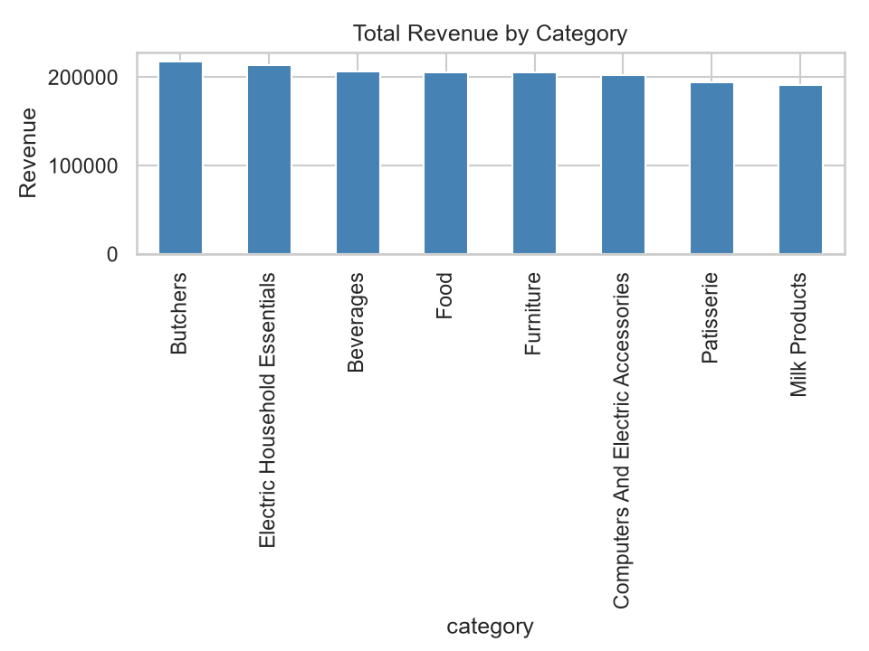
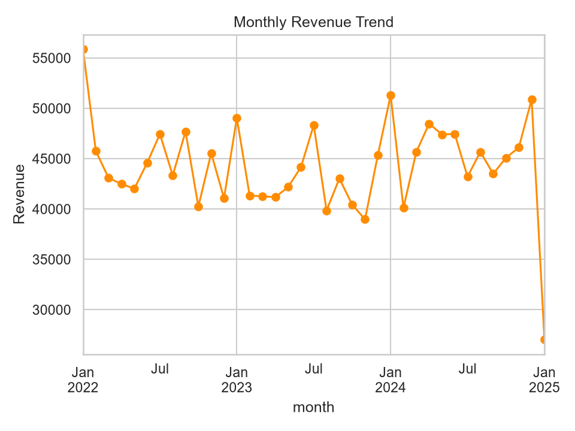
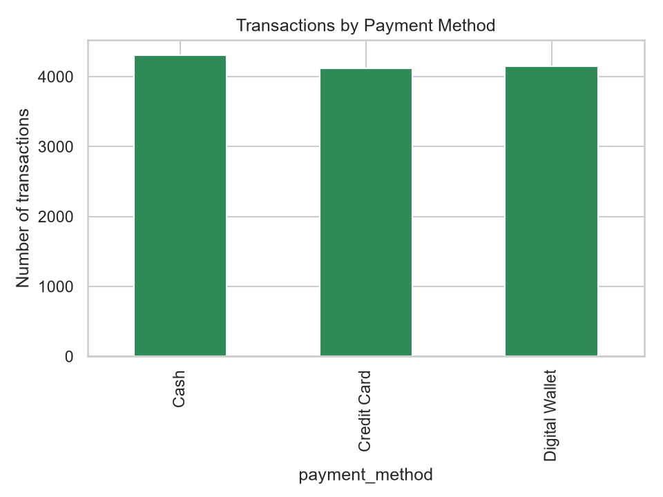
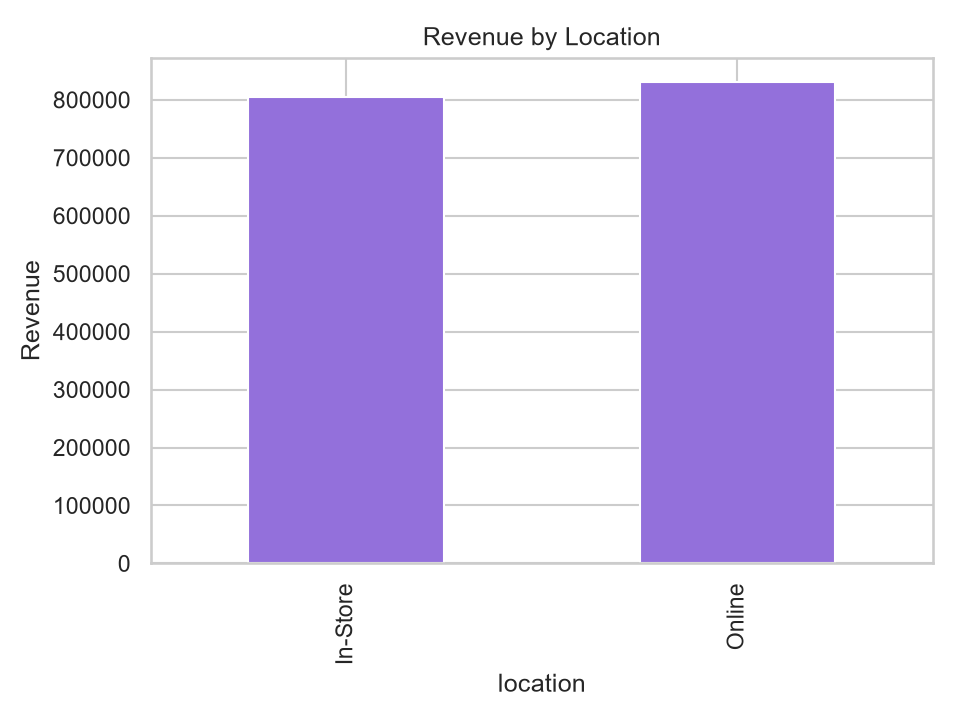
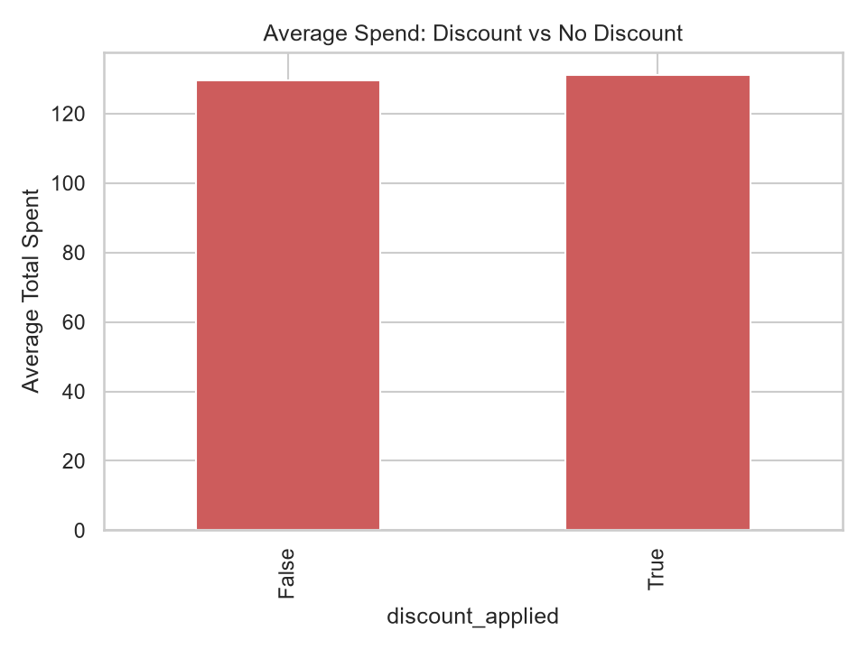
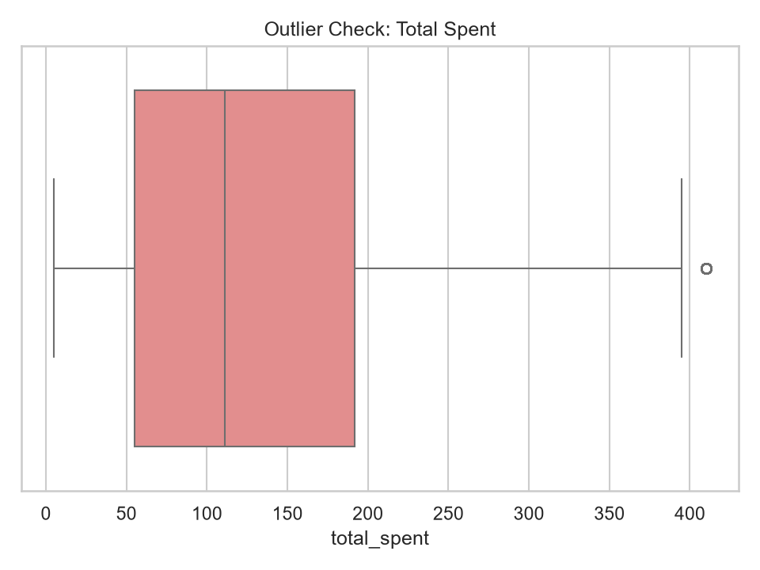
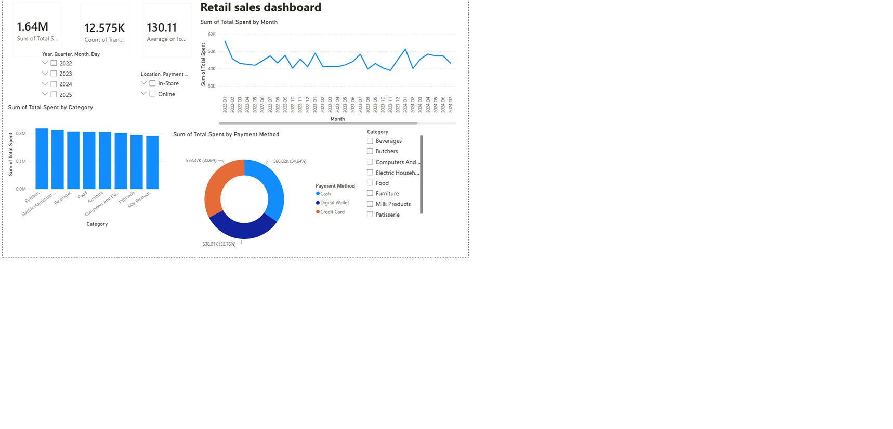

# SWYNEX Technologies — Final Data Analytics Project

**Retail Sales Analytics: From Raw Data to Business Insights**

**Intern:** Kajal

## Problem Statement
A retail business has raw transaction data that is messy, inconsistent and not ready for decision-making. The goal of this project is to clean the data, explore it to find patterns, build an interactive dashboard and turn the findings into clear business insights.

## Dataset
- Source: Kaggle — *Retail Store Sales (Dirty)* dataset
- Columns: Transaction ID, Customer ID, Category, Item, Price Per Unit, Quantity, Total Spent, Payment Method, Location, Transaction Date, Discount Applied
- Size after cleaning: 12,575 transactions
- Period covered: 1 Jan 2022 to 18 Jan 2025

## 1. Data Cleaning (Python / Pandas)
Issues found: duplicate records, missing values, wrong data types, inconsistent text and dates, and Total Spent not always equal to Price × Quantity.

Steps taken:
1. Converted Transaction Date to datetime and Price, Quantity and Total Spent to numeric
2. Standardized text fields (whitespace, title case) in Category, Item, Payment Method and Location
3. Normalized Discount Applied to True/False
4. Filled missing Quantity with the median and missing Price Per Unit with the item-wise median
5. Recomputed Total Spent where it was missing or incorrect
6. Dropped rows missing an irrecoverable identifier
7. Removed duplicate transactions

## 2. Exploratory Data Analysis
- Total revenue: 1,636,195.50
- Total transactions: 12,575
- Average transaction value: about 130.11
- Outliers: 56 rows (0.4%) by the IQR rule








## 3. Interactive Dashboard (Power BI)
KPI cards, category / trend / payment charts and filters for Category, Location, Payment Method and Transaction Date, with cross-filtering across visuals.



## 4. Key Business Insights
1. **Payment methods are evenly split:** Cash 34.6%, Digital Wallet 32.8%, Credit Card 32.6% of revenue.
2. **Online and In-Store are almost equal:** Online earned 831,145 (50.8%) vs In-Store 805,050.5 (49.2%), with similar average order values (130.81 vs 129.41).
3. **Discounts barely change spending:** average spend is 131.13 with a discount vs 129.60 without (about 1.2% higher).
4. **The data is consistent:** only 0.4% of transactions are outliers.
5. 5. **Monthly revenue varies:** the peak was Jan 2022 (55,886). Jan 2025 shows the lowest revenue (27,033.5), but the data covers that month only until 18 Jan 2025, so it is a partial month.

## Recommendations
- Keep all three payment options available, since customers use them almost equally.
- Invest in both online and in-store channels equally.
- Review the discount strategy, because discounts do not noticeably increase basket size.

## Tools Used
Python (Pandas, Matplotlib, Seaborn), Power BI Desktop, GitHub

## Repository Structure
```
data/        raw_data.csv, cleaned_data.csv
code/        clean_data.py, eda_analysis.py
charts/      EDA charts
dashboard/   Power BI file and screenshot
```

## Related Repositories
- Data Cleaning: https://github.com/hhkajal8-cloud/SWYNEX-data-cleaning-preparation
- Exploratory Data Analysis: https://github.com/hhkajal8-cloud/SWYNEX-Exploratory-data-analysis
- Interactive Dashboard: https://github.com/hhkajal8-cloud/SWYNEX-Interactive-Dashboard
